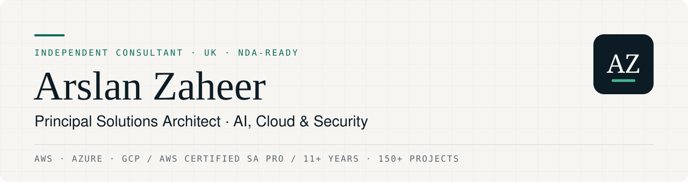

<a href="https://arslanzaheer.com">
  <picture>
    <source media="(prefers-color-scheme: dark)" srcset="./assets/banner-dark.svg">
    
  </picture>
</a>

  
  
  
  

### Most products need four specialists: a developer, a DevOps engineer, an AI specialist and a security reviewer. I do all four, so nothing gets lost in the handoffs.

I’m an independent consultant based in the UK. I design, build and secure AI systems, cloud platforms and SaaS products for scale-ups, enterprises and investors, and I work directly with you: no agency, NDA-ready. I’m also the founder of [**Brakeproof**](https://brakeproof.com), a safety layer for AI agents.

<table>
  <tr>
    <td><b>11+</b> years</td>
    <td><b>150+</b> projects</td>
    <td><b>22+</b> countries</td>
    <td><b>AWS SA Pro</b> certified</td>
    <td><b>2026</b> Cybersecurity Engineer of the Year</td>
  </tr>
</table>

---

## What I do

| | Service | |
|---|---|---|
| 🧠 | **AI agents & RAG** — production LLM systems grounded in your data | [Details →](https://arslanzaheer.com/services/ai-agent-development) |
| 🛡️ | **AI red-teaming & LLM evaluation** — prompt injection, jailbreaks, honest test sets | [Details →](https://arslanzaheer.com/services/ai-red-teaming) |
| 🔍 | **Technical due diligence** — independent code and architecture review for investors and acquirers | [Details →](https://arslanzaheer.com/services/technical-due-diligence) |
| 🔐 | **Security & compliance** — SOC 2 and ISO 27001 readiness, AppSec | [Details →](https://arslanzaheer.com/services/soc-2-iso-27001) |
| ☁️ | **Cloud architecture** — AWS, Azure and GCP, secure and multi-region | [Details →](https://arslanzaheer.com/services/cloud-architecture) |
| 🧭 | **Fractional CTO** — architecture, hiring and delivery leadership | [Details →](https://arslanzaheer.com/services/fractional-cto) |

## Selected work

| Project | What it is |
|---|---|
| [**Brakeproof**](https://arslanzaheer.com/work/brakeproof) | My own product: an action firewall, spend brake and red-team tests for AI agents |
| [**AI evaluation audit**](https://arslanzaheer.com/work/ai-memory-test-audit) | Independent audit of an AI system’s tests — false passes cut from 153 to 15 |
| [**Kaivo**](https://arslanzaheer.com/work/kaivo) | Multi-tenant ad operations platform with a grounded AI assistant |
| [**Point.Laz**](https://arslanzaheer.com/work/pointlaz) | Industrial AI and 3D digital twins for underground mine safety |
| [**VentureFract**](https://arslanzaheer.com/work/venturefract) | Moving a venture investing platform from a Lovable prototype to FastAPI |
| [**MyRoofAI**](https://arslanzaheer.com/work/myroofai) | Rescued and secured an AI quoting tool that was being used for phishing |

[See all case studies →](https://arslanzaheer.com/work)

## Credentials

- **AWS Certified Solutions Architect – Professional**
- **Databricks Certified Generative AI Engineer**
- **MSc Cyber Security**, University of Portsmouth
- **Cybersecurity Engineer of the Year 2026**, Corporate LiveWire
- **Toptal Verified Expert** · **Upwork Top Rated Plus** (top 3%)
- AI evaluation, red-teaming and training work for Mercor, Turing, Uber AI Solutions, DataAnnotation and others

## Stack

   
  

**AI:** OpenAI · Anthropic Claude · Gemini · LangGraph · LangChain · pgvector · MCP · evaluation harnesses

---

  <b>Have a product that can’t afford to get it wrong?</b> 
  <a href="https://calendly.com/arslan-arslanzaheer/kickoff-meeting">Book a free 1-hour call</a> · <a href="https://arslanzaheer.com/proposal">Request a proposal</a>

